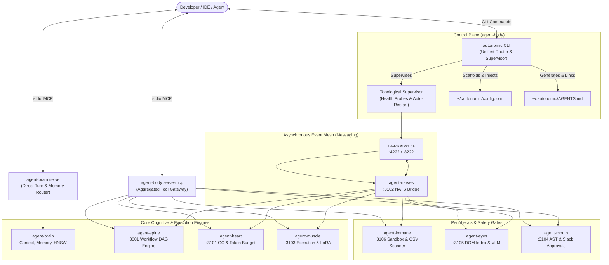
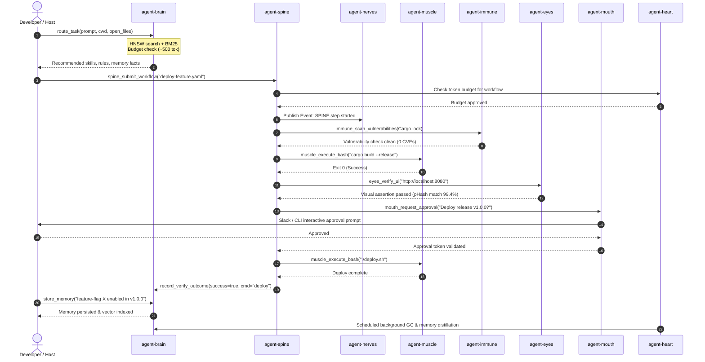

# Autonomic AI Ecosystem: Comprehensive Architectural & Operational Context

> **The Kubernetes for AI Agents** — Complete architectural deep dive, component taxonomy, cross-daemon protocols, and operational reference for `agent-body` and the entire Autonomic AI cluster.  
> **Target Version:** v1.0.0-beta.3.3 ecosystem baseline  
> **Documentation Hub:** [https://autonomic-ai.dev/docs/supervision](https://autonomic-ai.dev/docs/supervision) · Architecture: [https://autonomic-ai.dev/docs/architecture](https://autonomic-ai.dev/docs/architecture)  
> **Workspace Root:** `~/.autonomic/` (`config.toml`, `memory/`, `broker/`, `state/`, `logs/`, `agents/`)

---

## 1. Executive Summary & Architecture Paradigm

### 1.1 The Shift from Monolith to Cloud-Native Agent Runtimes
Early agent frameworks (LangChain, AutoGen, CrewAI) implemented monolithic Python loops where memory, tools, workflow sequencing, sandboxing, and LLM calls executed within a single OS process. In production, this architecture collapses under:
1. **Context Window Saturation:** Loading complete tool libraries, rule books, and session histories bloats prompts and degrades reasoning quality.
2. **Crash Cascades:** A panic in an execution tool or a leak during long-running tasks kills the entire agent session and loses state.
3. **Absence of Concurrency & Guarantees:** Multi-agent collaboration without an asynchronous message broker results in deadlocks, race conditions, and lack of replayability.
4. **Host Friction:** Fragmented configuration across IDEs (Cursor, Claude Code, OpenCode, Codex, Gemini/Antigravity) leads to divergent agent behavior.

### 1.2 The Autonomic Cluster Architecture
**Autonomic AI treats agentic software engineering as a distributed systems problem.** It decomposes the agent runtime into specialized, independent Rust daemons (codenamed *organs*) that communicate via strictly typed interfaces:
- **MCP (Model Context Protocol):** Synchronous tool invocation and turn routing over stdio and JSON-RPC.
- **HTTP / REST:** Health probes, workflow submissions, and real-time status meshes.
- **NATS JetStream:** High-throughput, persistent asynchronous pub/sub event mesh with replay and backpressure.

**`agent-body`** is the **Cluster Control Plane** (`kubectl` / `systemd` analog) that supervises, configures, boots, and aggregates these daemons into a coherent local or distributed operating environment.



---

## 2. Comprehensive Repository Deep Dive

Every repository in `autonomic-ai-dev` implements a discrete cloud-native role:

```
┌────────────────────────────────────────────────────────────────────────────────────────┐
│                                   AUTONOMIC AI STACK                                   │
├───────────────────┬───────────────────┬────────────────────────┬───────────────────────┤
│ Repository        │ Cloud-Native Role │ Binary / Port          │ Core Specialty        │
├───────────────────┼───────────────────┼────────────────────────┼───────────────────────┤
│ agent-body        │ Control Plane     │ autonomic (MCP stdio)  │ Supervisor & Gateway  │
│ agent-brain       │ Storage / PV      │ agent-brain (stdio)    │ Turn Router & Memory  │
│ agent-spine       │ Workflow Engine   │ agent-spine (:3001)    │ DAG State Machine     │
│ agent-heart       │ Controller / GC   │ agent-heart (:3101)    │ Budget & Memory Decay │
│ agent-nerves      │ Service Mesh      │ agent-nerves (:3102)   │ NATS JetStream Bridge │
│ agent-muscle      │ CRI Runtime       │ agent-muscle (:3103)   │ Execution & Training  │
│ agent-immune      │ Policy / OPA      │ agent-immune (:3106)   │ Sandboxing & Security │
│ agent-eyes        │ Observability     │ agent-eyes (:3105)     │ DOM & Visual QA       │
│ agent-mouth       │ Ingress Gateway   │ agent-mouth (:3104)    │ AST Safety & Approvals│
│ agent-tui         │ Terminal UI       │ agent-tui              │ Terminal Dashboard    │
│ agent-ci-dashboard│ Telemetry Console │ Web App (:5173/Vercel) │ CI/CD Mission Control │
│ agent-benchmarks  │ Conformance Suite │ pytest / cargo         │ Conformance & SLAs    │
└───────────────────┴───────────────────┴────────────────────────┴───────────────────────┘
```

---

### 2.1 `agent-body` — The Control Plane & Meta-Orchestrator
- **Role:** Control Plane (`kubectl`, apiserver, and `kubelet` supervisor).
- **Core Internals:**
  - `supervisor.rs`: Manages daemon lifecycles with topological readiness ordering, polling `/health` endpoints and PID files (`~/.autonomic/state/supervisor/`), with exponential backoff restarts.
  - `mcp_gateway.rs`: Dynamic MCP gateway exposing aggregated organ tools over stdio (`muscle_*`, `heart_*`, `spine_*`, etc.).
  - `router.rs`: Transparent command router dispatching `autonomic <organ>` commands with auto-injected `--config ~/.autonomic/config.toml`.
  - `init.rs`: Workspace scaffolding for `~/.autonomic/`.
  - `agents.rs`: Aggregates modular prompt fragments in `~/.autonomic/agents/` into a single `~/.autonomic/AGENTS.md` and symlinks it to all installed IDEs.
  - `doctor.rs`: Comprehensive pre-flight health audit verifying:
    - Binaries on `$PATH` and executable readiness.
    - Ecosystem version compatibility matrix enforcing `MIN_COMPATIBLE_VERSION = "1.0.0-beta.1"`.
    - Darwin arm64 code signatures and quarantine clearing (`prepare_macos_binary`: `xattr -cr` and `codesign --verify --verbose=2`, preserving Apple Developer ID signatures and strictly avoiding ad-hoc re-signing).
    - Port bindings and socket listeners (`:4222`, `:3001`, `:3101`-`:3106`, `:3200`).
    - Database schemas, advisory serve locks, and fallback memory queues.
- **Key CLI Verbs:**
  - `autonomic init [--name <proj>]`: Initialize workspace and scaffold config.
  - `autonomic start | stop | restart | supervise`: Supervisor lifecycle commands.
  - `autonomic doctor [--quick] [--stats]`: System-wide audit enforcing `1.0.0-beta.1` compatibility baseline.
  - `autonomic status`: Real-time PID, health, and port allocation table.
  - `autonomic serve-mcp`: Start aggregated stdio MCP gateway.
  - `autonomic serve-health`: Expose HTTP health mesh on port `3200`.
  - `autonomic update [--force]`: Pull latest binary releases from GitHub. Enforces semantic pre-release isolation (`is_prerelease()` check prevents stable installs from automatically jumping to pre-releases and vice-versa, unless `--force` is specified).

---

### 2.2 `agent-brain` — The Memory Store & Turn Router
- **Role:** PersistentVolumes, ConfigMaps, and Local Cognitive Router.
- **Core Internals:**
  - `engine.rs` & `turn_cache.rs`: Hybrid BM25 + dense embedding (AllMiniLML6V2) retrieval engine that selects budgeted skills, rules, and memory per turn (~500 tokens).
  - `db/store.rs` & `db/migrations.rs`: SQLite database (`brain.db`) with sqlite-vec / HNSW BLOB embeddings, FTS5 full-text search, and WAL mode.
  - `serve_lock.rs`: Exclusive advisory file lock (`serve.lock`) preventing concurrent `serve` processes from corrupting state.
  - `memory_pending.rs`: Resilient fallback queue (`~/.autonomic/memory/pending/`) that enqueues durable memories when MCP sockets disconnect, flushed via `memory flush-pending`.
  - `verify.rs`: Verification tracking engine hashing `.verify/` playbooks and logging command execution results.
  - `hooks/route_gate.py`: Multi-host enforcement hook blocking native tools until `route_task` succeeds, while enforcing scout-unlock and Python Shell execution policies.
- **Key MCP Tools:**
  - `route_task`: Primary turn routing tool (budgeted context, skills, rules, memory).
  - `store_memory` / `list_memory` / `delete_memory`: Long-term fact persistence.
  - Prefer `agent-brain verify --` over MCP `record_verify_outcome` (MCP exits not trusted for learning).
  - `file_summary` / `read_file_head` / `read_file_tail` / `grep_search`: Bounded file inspection (unlocks native Read/StrReplace).
- **Key CLI Verbs:**
  - `agent-brain serve`: Run stdio MCP server.
  - `agent-brain install [--global] [--all]`: Install host hooks and configs.
  - `agent-brain verify -- <cmd>` / `agent-brain report`: Run/record verification.
  - `agent-brain memory put | enqueue | flush-pending`: Resilient memory writes.
  - `agent-brain bootstrap`: Join portable git sync cluster.

---

### 2.3 `agent-spine` — The Deterministic Workflow Engine
- **Role:** Workflow Engine (Argo Workflows / Temporal analog for agents).
- **Port:** `3001` (HTTP API) / `3100` (Dashboard relay).
- **Core Internals:**
  - `workflow.rs` & `executor/`: Executes YAML-defined Directed Acyclic Graph (DAG) workflows with step dependencies, inputs/outputs, retries, and conditional branches.
  - `state.rs`: SQLite-backed state machine tracking workflow execution history, node transitions, and task snapshots.
  - `jetstream_bridge.rs`: Publishes lifecycle events to NATS JetStream topics (`SPINE.workflow.>`) for distributed cluster coordination.
  - `budget_gate.rs`: Integrates with `agent-heart` to evaluate token costs before initiating expensive workflow steps.
  - `brain_router.rs`: Queries `agent-brain` to dynamically resolve required skills or rules for individual workflow steps.
- **Key MCP Tools:**
  - `spine_submit_workflow`: Launch a workflow from an inline YAML or registered template.
  - `spine_workflow_status`: Query execution state, active steps, and outputs.
  - `spine_approve_step`: Approve blocked human-in-the-loop workflow nodes.
  - `spine_cancel_workflow`: Terminate active DAG execution.
- **Key CLI Verbs:**
  - `agent-spine serve`: Start HTTP server and JetStream listener.
  - `agent-spine run <workflow.yaml>`: Run a workflow synchronously.
  - `agent-spine status <workflow-id>`: Inspect workflow progress.
  - `agent-spine registry list`: List curated workflows.

---

### 2.4 `agent-heart` — The Background Controller & Token Gate
- **Role:** Controller Manager, Token Budget Gate, and Garbage Collector.
- **Port:** `3101` (HTTP API).
- **Core Internals:**
  - `token_budget.rs`: Sliding-window token accounting across agents, models, and sessions with configurable soft and hard limits.
  - `pid_throttle.rs`: Dynamic backpressure and rate limiting applied when token consumption velocity spikes.
  - `scheduler.rs`: Background cron engine running scheduled maintenance tasks.
  - `distillation.rs`: Memory distillation engine identifying stale, redundant, or contradictory facts in `brain.db` and synthesizing high-level summaries.
  - `brain_client.rs`: Triggers SQLite VACUUM, index re-indexing, and memory archiving via `agent-brain gc`.
- **Key MCP Tools:**
  - `heart_budget_status`: Query current token consumption against limits.
  - `heart_budget_spend`: Record or pre-authorize token usage for an operation.
  - `heart_gc`: Manually trigger a memory garbage collection sweep.
  - `heart_distill`: Run memory consolidation and distillation.
- **Key CLI Verbs:**
  - `agent-heart serve`: Run background controller daemon.
  - `agent-heart gc [--apply]`: Run memory cleanup.
  - `agent-heart budget check`: Inspect current token burn rate.

---

### 2.5 `agent-nerves` — The Distributed Agent Mesh
- **Role:** Service Mesh and Event Bridge (NATS JetStream abstraction).
- **Port:** `3102` (HTTP API / NATS bridge).
- **Core Internals:**
  - `jetstream.rs` & `stream.rs`: Manages durable NATS JetStream streams (`AUTONOMIC_EVENTS`, `SPINE_EVENTS`, `TELEMETRY`) with at-least-once delivery and message deduplication.
  - `cluster.rs`: Node discovery, peer pinging, and heartbeat tracking across multi-machine setups.
  - `backpressure.rs`: Message flow regulation ensuring fast producers don't overwhelm slow LLM inference consumers.
  - `wasm_filter.rs`: Executes lightweight WebAssembly filters on event streams before propagating messages to agents.
- **Key MCP Tools:**
  - `nerves_publish`: Emit an event onto a NATS subject.
  - `nerves_subscribe`: Listen for events matching a subject pattern.
  - `nerves_stream_tail`: Inspect recent messages from a JetStream log.
  - `nerves_ping`: Probe connectivity to the NATS message mesh.
- **Key CLI Verbs:**
  - `agent-nerves serve`: Run NATS event bridge daemon.
  - `agent-nerves stream list`: Inspect active JetStream streams.
  - `agent-nerves tail <subject>`: Live stream consumer in terminal.

---

### 2.6 `agent-muscle` — The Execution Runtime & Training Engine
- **Role:** CRI Runtime (`kubelet` analog for tool and script execution).
- **Port:** `3103` (HTTP API).
- **Core Internals:**
  - `executor.rs`: Bounded command runner with hard timeouts, environment isolation, resource cgroups, and working directory sandboxing.
  - `finetune/` & `train.rs`: Local and remote LoRA/QLoRA fine-tuning orchestration using unsloth/PyTorch backends.
  - `trace_collector.rs` & `preference_pairs.rs`: Automatically captures execution trajectories and tool interactions to format DPO/RLHF dataset pairs.
  - `lora_hot_swap.rs`: Hot-swaps LoRA adapter weights in active local inference servers (e.g. vLLM, Ollama).
  - `jetstream_consumer.rs`: Consumes async execution requests from NATS topics (`MUSCLE.exec.>`).
- **Key MCP Tools:**
  - `muscle_execute_bash`: Run a bash command in a sandboxed, monitored environment with automatic in-gateway AST safety validation via `agent-mouth`.
  - `muscle_train_lora`: Trigger a background LoRA training run.
  - `muscle_hot_swap_adapter`: Activate a fine-tuned LoRA adapter.
- **Key CLI Verbs:**
  - `agent-muscle serve`: Start execution daemon.
  - `agent-muscle run "<cmd>"`: Execute command with timeout and isolation.
  - `agent-muscle train --dataset <path>`: Launch model fine-tuning.

---

### 2.7 `agent-immune` — Zero-Trust Security & Sandbox Policy
- **Role:** Admission Controller, OPA Gatekeeper, and Vulnerability Guard.
- **Port:** `3106` (HTTP API).
- **Core Internals:**
  - `scanner.rs`: Integrates with the Open Source Vulnerability (OSV) database to audit package manifests (`Cargo.lock`, `package.json`, `poetry.lock`).
  - `wasm_sandbox.rs` & `firecracker.rs`: Provides dual-layer microVM (Firecracker) and Wasm (Wasmtime) isolation for untrusted code execution.
  - `seccomp.rs`: Generates strict Linux seccomp BPF filters blocking unauthorized syscalls (e.g., ptrace, mount, network creation).
  - `leak_check.rs`: Memory profiling engine detecting RSS memory growth anomalies across agent iterations.
- **Key MCP Tools:**
  - `immune_scan_vulnerabilities`: Audit dependency manifests for CVEs.
  - `immune_sandbox_run`: Execute untrusted code inside a micro-sandbox.
  - `immune_check_leak`: Inspect memory consumption trends.
- **Key CLI Verbs:**
  - `agent-immune serve`: Start security daemon.
  - `agent-immune scan <path>`: Run vulnerability scan on dependencies.
  - `agent-immune sandbox run --wasm <file.wasm>`: Execute in Wasm sandbox.

---

### 2.8 `agent-eyes` — Observability & Visual Verification
- **Role:** Observability, DOM Parsing, and Visual State Extraction.
- **Port:** `3105` (HTTP API).
- **Core Internals:**
  - `dom_index.rs`: Parses HTML/browser DOM structures into compact accessibility trees formatted specifically for LLM context windows.
  - `dom_diff_coalesce.rs`: Deduplicates rapid UI mutations into semantic delta summaries, conserving tokens.
  - `phash_cascade.rs`: Multi-scale perceptual hashing (pHash) for lightning-fast visual regression detection across screenshots.
  - `vlm/` & `describe.rs`: Interfaces with local or remote Vision-Language Models to produce structured descriptions of UI state.
- **Key MCP Tools:**
  - `eyes_capture`: Take a screenshot of an active display, window, or headless browser.
  - `eyes_index_dom`: Extract accessibility-indexed DOM trees from a web page.
  - `eyes_diff_screenshots`: Visually compare baseline vs. test images.
  - `eyes_verify_ui`: End-to-end visual QA assertion tool.
- **Key CLI Verbs:**
  - `agent-eyes serve`: Start observability daemon.
  - `agent-eyes capture --out <file.png>`: Screen capture utility.
  - `agent-eyes dom --url <url>`: Extract indexed DOM.

---

### 2.9 `agent-mouth` — The I/O Safety & Approval Gateway
- **Role:** Ingress Gateway, AST Safety Validator, and Notification Dispatcher.
- **Port:** `3104` (HTTP API).
- **Core Internals:**
  - `approval.rs`: Human-in-the-loop (HITL) gate that pauses dangerous operations, dispatches interactive approval requests (Slack, CLI, webhooks), and verifies cryptographic approval tokens.
  - `local_inference.rs` & `summarize.rs`: Local LLM pipeline generating executive summaries of proposed actions for human reviewers.
  - `notify.rs`: Multi-channel notification dispatcher supporting Slack, Discord, email, and generic webhooks.
- **Key MCP Tools:**
  - `mouth_request_approval`: Block execution until a human operator approves the step.
  - `mouth_send_notification`: Emit alerts to configured team channels.
  - `mouth_summarize`: Generate high-level status summaries.
- **Key CLI Verbs:**
  - `agent-mouth serve`: Start gateway daemon.
  - `agent-mouth send --channel slack --message "..."`: Send alert.
  - `agent-mouth approve <request-id>`: Manually resolve an approval gate.

---

### 2.10 `agent-tui`, `agent-ui`, & `agent-benchmarks`
- **`agent-tui` (Terminal UI):** High-performance Ratatui terminal dashboard showing live CPU, RSS memory, health probes, and log streams for all autonomic processes. Launched via `autonomic tui`.
- **`agent-ui` (Web UI):** Modern SvelteKit/React dashboard connecting via WebSocket relay (`autonomic ui`) to provide cluster visual graphs, memory exploration, and workflow DAG visualizations.
- **`agent-benchmarks` (Ecosystem Conformance):** Pytest and Cargo benchmark suite validating recall accuracy (Recall@3 ≥ 0.85), p95 route latency (≤ 30ms), and SLA stability across releases.

---

## 3. End-to-End Multi-Agent Execution Lifecycle

The following sequence illustrates how the entire Autonomic stack collaborates during an autonomous engineering task:



---

## 4. Dual-Mode MCP Architecture: Direct vs. Gateway

Autonomic AI provides two distinct MCP servers that should be mounted side-by-side in orchestrators:

```
┌────────────────────────────────────────────────────────────────────────┐
│                        IDE / Agent Host Window                         │
│             (Cursor / Claude Code / OpenCode / Antigravity)            │
└───────────────────┬────────────────────────────────┬───────────────────┘
                    │                                │
            stdio MCP connection             stdio MCP connection
                    ▼                                ▼
       ┌──────────────────────────┐    ┌──────────────────────────┐
       │    agent-brain serve     │    │   agent-body serve-mcp   │
       │       (DIRECT MODE)      │    │      (GATEWAY MODE)      │
       └────────────┬─────────────┘    └────────────┬─────────────┘
                    │                               │
           Cognitive Turn Loop              Cluster Capabilities
         - route_task                     - muscle_execute_bash
         - store_memory                   - spine_submit_workflow
         - record_verify_outcome          - immune_scan_vulnerabilities
         - file_summary / read_head       - eyes_capture_screen
         - grep_search                    - mouth_request_approval
         - Memory fallback queue          - heart_budget_status
```

### Why Two MCP Entry Points?
1. **Low Latency & High Frequency:** `agent-brain` must answer in `< 30ms` on every single model turn to deliver context without slowing down typing or streaming. Direct stdio communication avoids network hops.
2. **Failure Isolation:** Peripheral tools (`muscle`, `eyes`, `spine`) invoke child processes, web browsers, and external APIs. If an external tool experiences a transient hang or crash, it must never disrupt the agent's turn routing or memory store.
3. **Upstream Federation:** `agent-brain` can itself delegate upstream tool requests to `agent-body` via its built-in `route_to_mcp` tool.

---

## 5. Unified Configuration Reference

All daemons dynamically read from `~/.autonomic/config.toml`. Below is the complete, production-annotated configuration:

```toml
# ==============================================================================
# AUTONOMIC AI CLUSTER CONFIGURATION (~/.autonomic/config.toml)
# ==============================================================================

[autonomic]
workspace = "~/.autonomic"
log_level = "info"
progress_style = "auto"          # auto | plain | quiet
auto_restart_daemons = true

# ------------------------------------------------------------------------------
# CORE: agent-brain (Turn router, memory store, HNSW embeddings)
# ------------------------------------------------------------------------------
[brain]
home = "~/.autonomic/memory"
db_path = "~/.autonomic/memory/brain.db"
embedding_model = "AllMiniLML6V2"
route_gate_scope = "brain_mcp"   # brain_mcp (safe) | all (strict)
read_gate = "hard"               # hard | steer | off
scout_unlock_secs = 3600         # duration native read is unlocked after scouting
allow_multi_serve = false        # exclusive serve.lock protection
allow_python_shell = false       # deny python -c / heredocs on shell

# ------------------------------------------------------------------------------
# MESSAGING: NATS Server & agent-nerves (Service mesh)
# ------------------------------------------------------------------------------
[nerves]
nats_url = "nats://127.0.0.1:4222"
nats_monitor_url = "http://127.0.0.1:8222"
http_port = 3102
cluster_id = "autonomic-local"
enable_wasm_filters = true

# ------------------------------------------------------------------------------
# WORKFLOWS: agent-spine (Deterministic DAG engine)
# ------------------------------------------------------------------------------
[spine]
port = 3001
db_path = "~/.autonomic/state/spine/state.db"
workflow_dir = "~/.autonomic/workflows"
max_concurrent_steps = 8
enforce_budget_gate = true

# ------------------------------------------------------------------------------
# CONTROLLER: agent-heart (Token budget & memory GC)
# ------------------------------------------------------------------------------
[heart]
port = 3101
gc_interval_secs = 3600
token_budget_limit = 100000      # maximum tokens per task session
enable_distillation = true
distillation_schedule = "0 3 * * *"

# ------------------------------------------------------------------------------
# RUNTIME: agent-muscle (Execution & Training)
# ------------------------------------------------------------------------------
[muscle]
port = 3103
default_timeout_secs = 120
working_dir_sandbox = true
enable_lora_training = true
gpu_device = "0"

# ------------------------------------------------------------------------------
# SECURITY: agent-immune (Vulnerability & Sandboxing)
# ------------------------------------------------------------------------------
[immune]
port = 3106
osv_cache_dir = "~/.autonomic/cache/osv"
sandbox_backend = "wasm"         # wasm | firecracker | seccomp
deny_on_cve_severity = "high"

# ------------------------------------------------------------------------------
# OBSERVABILITY: agent-eyes (DOM indexing & Visual QA)
# ------------------------------------------------------------------------------
[eyes]
port = 3105
screenshot_dir = "~/.autonomic/captures"
phash_threshold = 0.95
headless_browser = true

# ------------------------------------------------------------------------------
# INGRESS: agent-mouth (Approvals & Notifications)
# ------------------------------------------------------------------------------
[mouth]
port = 3104
slack_webhook_url = ""           # secret reference or environment variable
approval_timeout_secs = 600
require_approval_for = ["deploy", "drop_db", "force_push"]
```

---

## 6. How to Use the Autonomic Ecosystem

### 6.1 Installation & Bootstrap

To bootstrap a developer laptop or CI machine with all release binaries:

```bash
# 1. One-line installer: downloads all release binaries, nats-server, and symlinks autonomic
curl -fsSL https://raw.githubusercontent.com/autonomic-ai-dev/agent-body/master/scripts/install-all-organs.sh | bash

# 2. Add ~/.local/bin to your environment ($PATH)
export PATH="$HOME/.local/bin:$PATH"

# 3. Pre-flight health verification
autonomic doctor

# 4. Initialize workspace and start daemons
autonomic init
autonomic start

# 5. Verify daemon states and health
autonomic status
```

### 6.2 Mounting MCP in Development Environments

Mount both direct turn routing and gateway execution tools in your editor:

**Cursor (`~/.cursor/mcp.json`):**
```json
{
  "mcpServers": {
    "agent-brain": {
      "command": "/Users/username/.local/bin/agent-brain",
      "args": ["serve"]
    },
    "agent-body": {
      "command": "/Users/username/.local/bin/agent-body",
      "args": ["serve-mcp"]
    }
  }
}
```

**Claude Desktop (`claude_desktop_config.json`):**
```json
{
  "mcpServers": {
    "agent-brain": {
      "command": "/Users/username/.local/bin/agent-brain",
      "args": ["serve"]
    },
    "agent-body": {
      "command": "/Users/username/.local/bin/agent-body",
      "args": ["serve-mcp"]
    }
  }
}
```

### 6.3 The Agent Operational Contract (Rules for AI Pair Programmers)

When an AI agent operates within an Autonomic-enabled environment, it must follow these behavioral invariants:
1. **Turn Start (Compulsory):** Call `agent-brain_route_task` (or `route_task`) with `user_message`, `current_working_directory`, and `open_files`. Treat returned `must_apply` rules as non-negotiable constraints.
2. **File Inspection (Anti-Bloat):** Prefer `file_summary`, `read_file_head`, `read_file_tail`, or `grep_search` over reading massive files directly. Scouting a path automatically unlocks native `read_file` / `replace_file_content` for that path for 1 hour.
3. **No Ad-Hoc Python Shell Scripts:** Do not run `python -c`, heredocs, or piped scripts to inspect files or bypass edit tools. Use native tools or project test suites.
4. **Delegate Workflows:** For multi-step procedures (e.g. migration + deploy + QA), submit a DAG workflow via `agent-spine` (`spine_submit_workflow`).
5. **Verify Outcomes:** Prefer `agent-brain verify -- <cmd>` (orchestrators: `--source orchestrator`). Do not rely on MCP `record_verify_outcome` for learning credit.
6. **Turn End (Memory Persistence):** At the conclusion of a milestone, call `store_memory` with a concise summary (max 50 words). If the MCP socket fails, write via CLI fallback: `autonomic brain memory put --topic ... --fact ...`.

---

## 7. Cluster Operations & Troubleshooting Runbook

### 7.1 Port Allocation Reference Table

| Service / Daemon | Port | Protocol | Purpose / Probes |
|------------------|------|----------|------------------|
| `nats-server` | `4222` | TCP (NATS) | JetStream client pub/sub |
| `nats-server` | `8222` | HTTP | `GET /healthz` readiness check |
| `agent-spine` | `3001` / `3100` | HTTP | Workflow submission & state API |
| `agent-heart` | `3101` | HTTP | `GET /health`, token budget inspection |
| `agent-nerves` | `3102` | HTTP | `GET /health`, NATS telemetry bridge |
| `agent-muscle` | `3103` | HTTP / MCP | Execution engine & training triggers |
| `agent-mouth` | `3104` | HTTP / MCP | Approval webhooks & alert dispatch |
| `agent-eyes` | `3105` | HTTP / MCP | DOM tree parsing & visual QA |
| `agent-immune` | `3106` | HTTP / MCP | OSV vulnerability scanner & sandboxing |
| `agent-body` | `3200` | HTTP | `GET /organs/health` aggregated health mesh |

### 7.2 Diagnosing and Recovering from Failures

#### Problem: Daemons fail to start or port conflict detected
```bash
# 1. Run cluster diagnostics
autonomic doctor

# 2. Check which processes hold required ports
lsof -i :4222
lsof -i :3101
lsof -i :3102

# 3. Cleanly terminate all supervised processes
autonomic stop

# 4. If processes were orphaned after a crash:
killall nats-server agent-nerves agent-heart agent-spine 2>/dev/null
rm -f ~/.autonomic/state/supervisor/*.pid

# 5. Boot fresh cluster
autonomic start
autonomic status
```

#### Problem: Agent receives "Tool execution error" on brain MCP
```bash
# 1. Check if multiple serve instances collided
lsof -p $(cat ~/.autonomic/memory/serve.lock 2>/dev/null)

# 2. Flush pending memory facts that survived the socket error
agent-brain memory flush-pending

# 3. Verify health and repair configuration
agent-brain doctor --fix
```

#### Problem: Workflow step blocked on human approval
```bash
# 1. Inspect blocked workflow ID
autonomic spine status

# 2. Approve the pending step
autonomic spine approve <workflow-id> --step <step-name>
```
